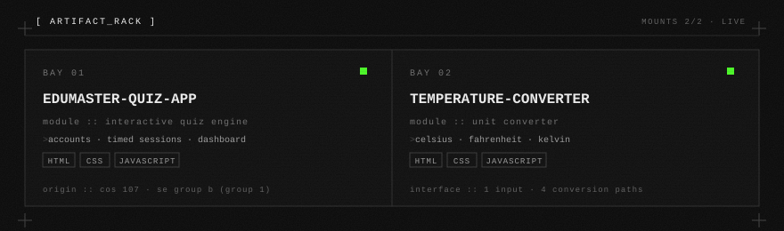

<picture>
  
</picture>

```text
$ cat /var/lib/AkabaneKarmX/identity.db

  ALIAS  :: AKABANEKARMX
  ROLE   :: SOFTWARE ENGINEERING STUDENT // BABCOCK UNIVERSITY
  STACK  :: HTML · CSS · JAVASCRIPT | C++ · PYTHON
  HOST   :: GITHUB.COM/AKABANEKARMX
```

## // DEPLOYED_ARTIFACTS

- [`edumaster-quiz-app`](https://github.com/AkabaneKarmX/edumaster-quiz-app) — quiz engine with user accounts, timed sessions and a performance dashboard. `html/css/js` — cos 107, software engineering group b (group 1).
- [`temperature-converter`](https://github.com/AkabaneKarmX/temperature-converter) — unit converter across celsius, fahrenheit and kelvin. `html/css/js`.

<p align="center">
  
</p>

## // CHANNELS

- [`@AkabaneKarmX`](https://github.com/AkabaneKarmX) — direct line
- packet routing — open an issue on any repository

```text
$ exit ── ▌
```
